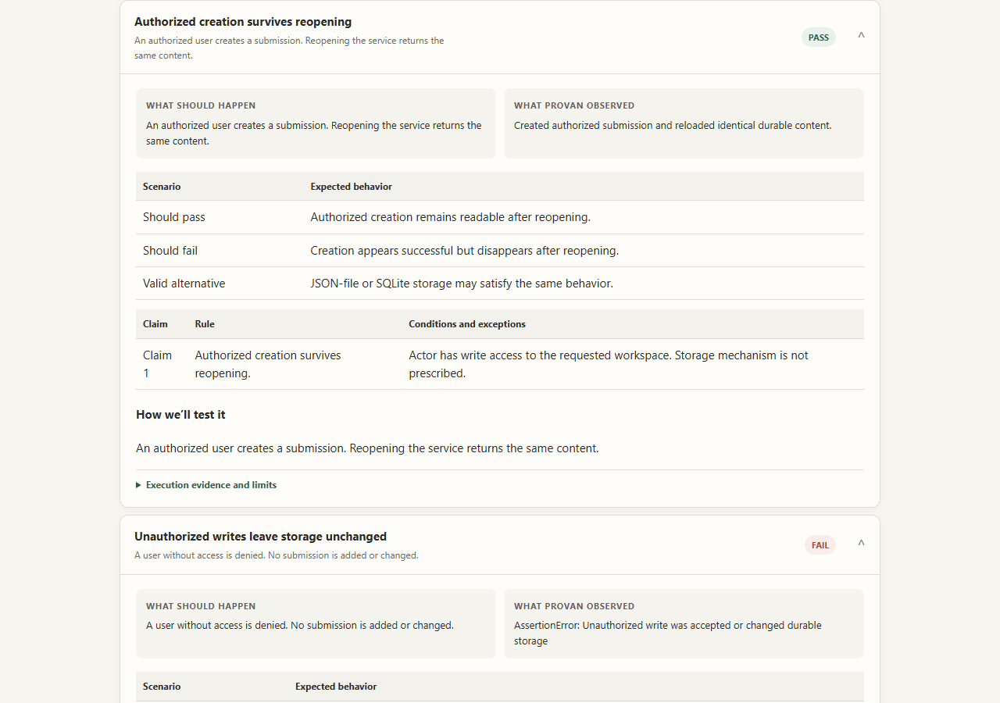

<p></p>

# Make acceptance visible. Keep evidence honest.

Provan inspects a change without running its code. Its private Contract Foundry prototype adds readable acceptance drafts, explicit owner decisions and bounded reference-test reports.

- **Understand a change:** inspect source structure and create a bounded Change Brief with the public CLI.
- **Trace the evidence:** follow requirements, code context and recorded limitations instead of treating a confident summary as proof.
- **Review what “done” means:** the private prototype shows proposed checks, exceptions and owner questions in one readable report.
- **Distinguish proposal from observation:** the controlled demonstration shows a real test failure and the same checks passing after a fix. This is not general production verification.

## See the working demonstration

**Private prototype — real controlled execution, not a public release:**




Read the **[GitHub-friendly showcase](docs/showcase/README.md)** now. It includes screenshots, the source and execution boundaries, and the two separate stories. To interact with the reports, download this repository and open **`docs/showcase/index.html`** locally. GitHub’s HTML file viewer does not render the report as a website. No hosted Pages URL is claimed.

### One concrete acceptance example

| Step | Demonstrated behavior |
|---|---|
| Requirement | A user without workspace write access must not create or change a durable submission. |
| Acceptance check | Attempt an unauthorized write, then reload storage and check that it is unchanged. |
| Defective implementation | Ordinary authorized creation passes. The acceptance suite detects an unauthorized durable write: **3 of 4 checks pass**. |
| Corrected implementation | The same frozen contract and tests assess the permission fix: **4 of 4 checks pass**. |
| Valid alternative | SQLite storage passes those same requirements; the contract does not prescribe JSON-file storage. |

This is a seeded, product-owned Python fixture with actual executed checks. It is not independently discovered production evidence, a secure customer-code sandbox or release clearance. The Twenty CRM example is separate: genuine saved model generation and a real local human decision, with **twelve binding blocker nodes and no Twenty runtime verification**.

## Public quick start

Requires Python 3.11+, Git and a virtual environment. From this repository:

```text
python -m venv .venv
# Activate .venv with the command for your shell.
python -m pip install .
provan --help
provan doctor --format json
python scripts/demo_read_only.py
```

The last command runs a local, credential-free source-inspection example and confirms its target stayed unchanged. It does not call a model or execute the target’s code. The commands were checked against a clean, non-editable installation built from public main. Run your own target inspections in source-only mode; keep `PROVAN_HOME` outside a Git repository.

See the [public quick start](docs/quickstart.md), [Change Brief](docs/change-brief.md), [Acceptance lifecycle](docs/acceptance-lifecycle.md), [product boundary](docs/product-boundary.md) and [capability matrix](docs/capability-qualification-matrix.md).

## Public code and private prototype

| Surface | Availability and limits |
|---|---|
| Public main | Source-only inspection, bounded Change Brief and existing Acceptance lifecycle. Unreleased main is not a product qualification or PyPI release. |
| Private `0.6.0.dev3` | Single-call Foundry, guided review commands and redesigned reports. **Not publicly installable.** |
| Controlled reference verifier | Executes only its registered product-owned fixture. No arbitrary customer-code execution or qualified runtime clearance. |
| Codex / Claude interface | Private CLI and thin skill interfaces; see the showcase for actual testing status. Agent subscriptions do not provide the configured API credential. |

Owner confirmation is not a successful test. A source-binding blocker is not a software failure. Model-generated checks and behavioral examples remain proposals until supported review and admissible execution establish more.

## Contribute and inspect the boundaries

Read [contribution guidance](CONTRIBUTING.md), [security guidance](docs/security.md), the [repository map](docs/repository-map.md) and [historical capability notes](docs/history.md). Telemetry is disabled by default; see [telemetry](docs/telemetry.md) before opting in.
