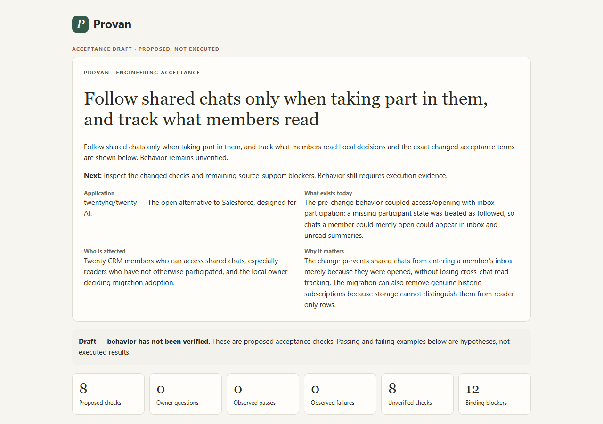
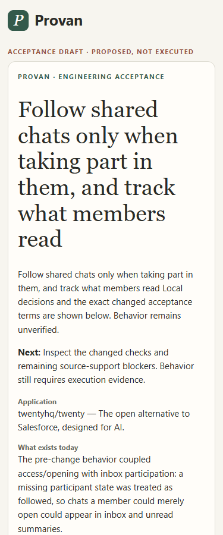
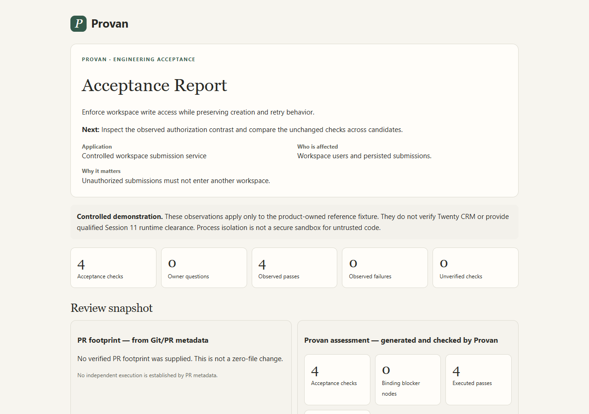

# Provan: two distinct demonstrations

These images come from actual Theme v2 reports. They are private prototype demonstrations, not publicly installable product features.

## 1. Twenty CRM: real generation and human review

A genuine installed single-call model response interpreted saved public PR #27786 and permitted context. The original sources, predecessor dependency and implementation-informed boundary were preserved. The local owner adopted the documented migration tradeoff: r7 and r8 became required locally, while rollback does not reconstruct every historic subscription choice. This was local adoption, not upstream maintainer authority.

The original draft and immutable successor retain twelve binding blocker nodes. No Twenty implementation tests ran. Incomplete support and mapping keep the result draft-only. Reports explain affected checks, dependent claims, work that can be inspected separately and concrete next actions.

[Original PR](https://github.com/twentyhq/twenty/pull/27786). The parent #27785 was closed unmerged; its later description is contextual, not invented original requirement authority.

## 2. Controlled Python application: real acceptance execution

The frozen requirements cover authorized durable creation, denied unauthorized writes, retry deduplication and workspace-scoped keys. Ordinary happy-path tests pass on the seeded defective version, while the acceptance suite detects the authorization defect. Exactly the same obligations and tests pass on the corrected candidate and a conforming SQLite alternative.

These are actual bounded local observations in a product-owned fixture. Scrubbed process isolation is not a secure sandbox. They do not verify Twenty CRM or establish qualified production clearance.

## Open the interactive reports

This Markdown page works directly on GitHub. For expandable checks and clickable source quotations, download the repository and open `docs/showcase/index.html` in a browser. All HTML is self-contained and uses no external assets. The index links the two stories separately.

The HTML files in GitHub’s normal source viewer are source code, not a rendered site. No GitHub Pages deployment is claimed.

## CLI and coding-agent status

The private successor offers one guided command family: `provan review start`, `questions`, `answer`, `report`, `verify` and `recheck`. Every operation has JSON parity. A first-time installed-user test exercises saved authentic review, explicit scripted decisions and blocked mapping; the controlled journey executes and rechecks the registered fixture. The genuine owner decision is preserved separately from test answers.

Codex exercised the command interface in this session. Claude Code is installed and its interface was inspected; no Claude agent workflow is claimed. Packaged skills establish compatibility instructions, not demonstrated agent behavior. Public main does not include these private commands.
